  

  

<table border="0" cellspacing="0" cellpadding="0">
  <tr>
    <td valign="middle" width="45%">
      
    </td>
    <td valign="top" width="55%" style="padding-left: 30 px;">
      
### Hi, I'm 🌸 **Samia** 🌸
      
I'm a CSE student who loves Space 🪐✨ and Nature 🪻🍃      
 

- 📚**Currently:** Learning about AI
- ✨ *Interests:* Space & Robotics
- 🕊️ *Contact:* [samiabassum099@gmail.com](mailto:samiabassum099@gmail.com)

    </td>
  </tr>
</table>

  

  

<picture>
  <source media="(prefers-color-scheme: dark)" srcset="https://raw.githubusercontent.com/cerealkiller0-0/cerealkiller0-0/pacman-output/pacman-contribution-graph-dark.svg">
  <source media="(prefers-color-scheme: light)" srcset="https://raw.githubusercontent.com/cerealkiller0-0/cerealkiller0-0/pacman-output/pacman-contribution-graph.svg">
  
</picture>
